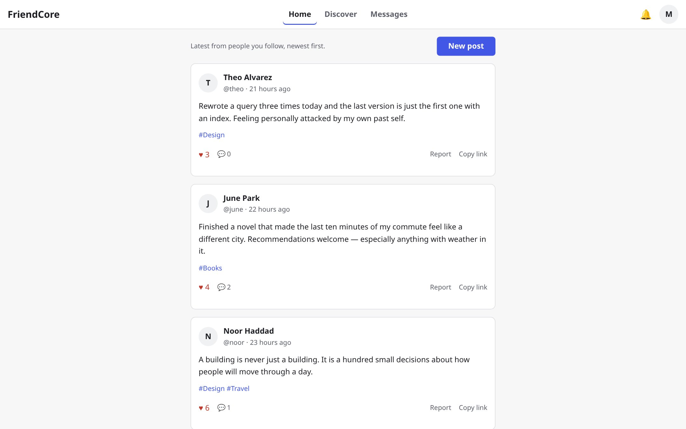
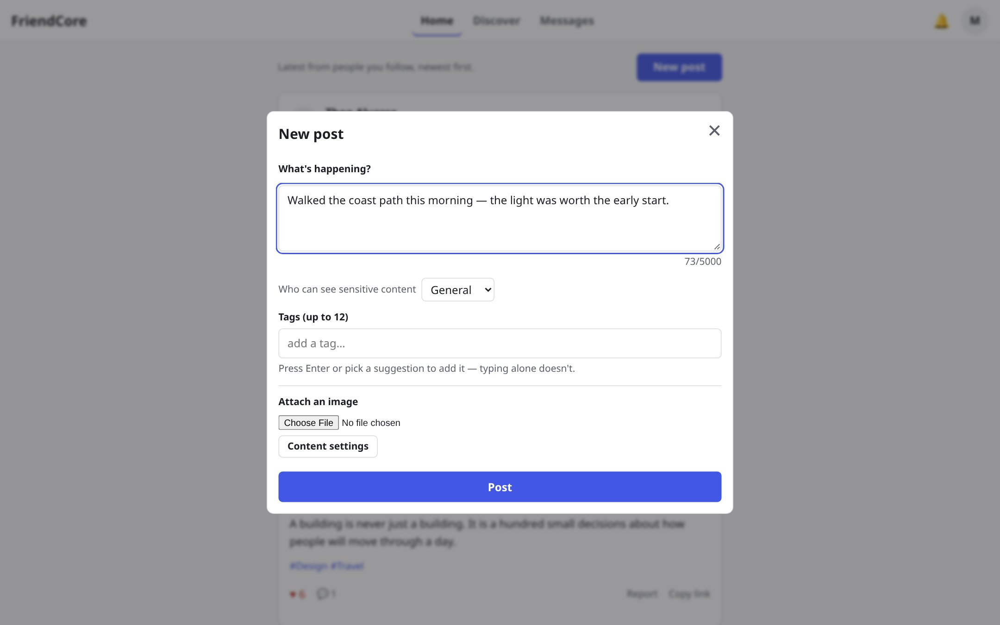
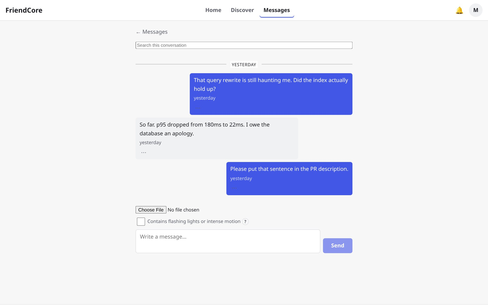
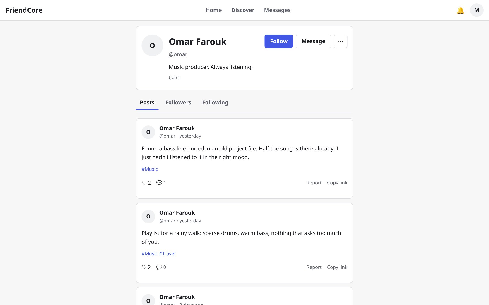

# FriendCore — Web client

The Angular front end for **FriendCore**, a privacy-first social platform with a
follow-only chronological feed, interest-based discovery, and real-time direct
messages. Built without a UI component library: every screen, token, and
interaction is custom.

[API repository](https://github.com/Needlide/FriendCore) · [Live demo](https://friend-core-client-ecb9d732c1d1.herokuapp.com/)

> The demo runs on free-tier infrastructure with seeded fictional accounts.
> Credentials are available on request.

## Screenshots



*Home — only posts from people you follow, newest first. No algorithm, no infinite scroll; a deliberate "Load more" at the end.*



*The composer opens in a native modal rather than occupying the feed. Drafts survive dismissal, and focus returns to the trigger on close.*



*1:1 messaging with replies, reactions, edit/delete, search, read state, and real-time delivery.*



*Profiles, follow state, and posts. Safety actions (report, block, mute) live behind the overflow menu.*

## What it is

FriendCore is a solo-built MVP of a social network that deliberately rejects
algorithmic feeds and engagement-driven UX. The product principles are visible in
the interface:

- **The feed is for reading.** Home is follow-only and strictly chronological.
  Posting is a deliberate action behind a **New post** button, not a form that
  owns the first screen.
- **No engagement traps.** No infinite scroll, autoplay, streaks, or
  re-engagement notifications.
- **Discovery by interest, not popularity.** People and posts are matched through
  shared tags chosen during onboarding.
- **Safety is part of the flow.** Sensitive media is blurred until revealed,
  reports are available on every content type, and moderation state is explained
  rather than hidden.
- **Accessibility is a requirement, not a retrofit.** Native dialogs, visible
  focus, keyboard-operable menus, reduced-motion support, and WCAG-reviewed
  tooltip behaviour.

## Feature map

| Route | Feature |
|---|---|
| `/auth/*` | Login, registration, email verification, forgot/reset password |
| `/` | Follow-only chronological feed with cursor pagination, optimistic delete, and post composer modal |
| `/discover` | Tag-matched people and posts, with follow/block/mute actions |
| `/u/:username` | Profile, follow state, posts, followers/following |
| `/posts/:id` | Post detail with comments, likes, and a likers dialog |
| `/messages` · `/messages/:id` | Conversation list and 1:1 thread: replies, reactions, edit/delete, search, read state, unread badges |
| `/notifications` | Notification list with per-row read/delete, mark-all-read, per-type mute, snooze |
| `/onboarding` | Interest selection and suggested follows |
| `/settings/*` | Profile, interests, preferences, keyword filters, blocks & mutes, appeals, account |
| `/admin/*` | Moderation dashboard, reports, appeals, users, tags, audit log (role-gated) |
| `/help` | Product and safety help |

## How it is built

- **Angular 22** with standalone components and **signals** for local state;
  RxJS is reserved for HTTP and realtime streams.
- **Fully lazy-loaded routes** — auth, feed, discovery, profiles, messaging,
  settings, and admin load as separate chunks.
- **Typed HTTP layer** with a single API client, per-endpoint services, and
  normalized error shapes. A single-flight refresh interceptor retries once on
  401 without stampeding the API.
- **SignalR** for notifications and messaging, with reconnect on a fresh access
  token.
- **Custom SCSS design system** — colour, spacing, type, radius, and motion
  tokens; light/dark themes; no Angular Material, Tailwind, or Bootstrap.
- **Native `<dialog>`** for the composer, content settings, reporting, and the
  media lightbox, so focus trapping and Escape handling come from the platform.
- **Accessibility work** includes skip links, semantic landmarks, labelled form
  errors, `aria-live` status messages, 44 px touch targets, `prefers-reduced-motion`
  support, and tooltips that meet WCAG 1.4.13 (hoverable, dismissible, persistent).
- **Same-origin production proxy** (`server.js`, Express + `http-proxy`) serves
  the SPA and forwards `/api` and `/hubs` to the API, WebSocket upgrades included.

### Project structure

```
src/app/
  core/          auth, API client, models, config, realtime
  features/      auth, feed, discovery, profile, messaging, notifications,
                 onboarding, settings, admin, safety, shared UI
  app.routes.ts  lazy route table
server.js        production SPA server + same-origin API proxy
docs/            UI plan, design system, screen/component inventory, a11y notes
```

The design documentation in `docs/` is treated as part of the codebase: screen
inventory, component contracts, copy rules, and accessibility checklists are kept
in sync with the implementation.

## Testing

```bash
npm test
```

**351 unit tests** across 52 files, using Vitest with jsdom through the Angular
test builder. HTTP is intercepted per test with `HttpTestingController`; realtime
behaviour is driven through subjects. The suite covers components, guards,
interceptors, services, form validation, and accessibility contracts.

The released build was additionally verified end-to-end in a real browser against
the deployed app: composer and dialog behaviour, focus restoration, tooltip
layering, console cleanliness, and a live publish flow.

## Run locally

Prerequisites: **Node 22 + npm 11**, and the API running locally (default
`http://localhost:5024`). The API repository's `docker-compose.dev.yml` provides
PostgreSQL, Redis, and object storage.

```bash
npm install
npm start
```

The app serves on `http://localhost:3000`, which is the API's default development
CORS origin. Keep local development on plain HTTP: the refresh cookie's `Secure`
flag follows the request scheme, so local HTTPS would silently drop it.

```bash
npm run build   # production bundle in dist/friendcore-client/browser
```

## Deployment

The production client is a small Express server (`server.js`) with two jobs:

1. Serve the built Angular app with SPA history fallback.
2. Reverse-proxy `/api` and `/hubs` to the API origin.

The proxy is not cosmetic. The API's refresh cookie is `SameSite=Strict`, and
`*.herokuapp.com` is on the Public Suffix List, so two Heroku apps are cross-site
and the cookie would never flow. Putting the API behind the client's origin makes
the browser see one site, exactly as in the intended single-domain production
layout.

`API_ORIGIN` selects the upstream API; `PORT` is supplied by the platform. The
Heroku build runs `ng build --configuration production` through
`heroku-postbuild`, and `Procfile` starts `node server.js`.

## Scope

This is an MVP, intentionally. The client implements the full scope described in
[`docs/UI-Plan.md`](docs/UI-Plan.md) for auth, feed, discovery, profiles, posts,
comments, likes, messaging, notifications, settings, and moderation. Deferred by
product decision: blogging, custom profile CSS/pages, creator monetisation, a
theme marketplace, end-to-end encrypted DMs, global user search, and a separate
mobile app. Post and comment editing are also out of scope for this milestone.

The backend's feature map, architecture, and test breakdown live in the
[API README](https://github.com/Needlide/FriendCore).

---

Built by [Max Lytvyniuk](https://github.com/Needlide).
